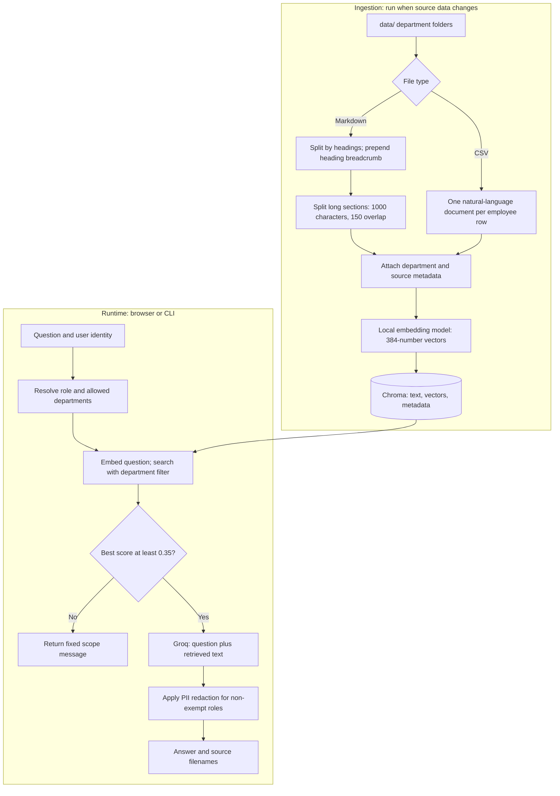

# FinSolve Internal Assistant

A role-aware chatbot that answers questions about FinSolve's internal documents using **retrieval-augmented generation (RAG)**. It searches a local knowledge base, passes relevant documents to a language model, and returns an answer with source filenames.

The project includes a browser interface, a command-line chatbot, department-based access control, an out-of-scope check, and basic personal-information redaction. Document embeddings run locally; answer generation uses **Groq Cloud**.

## Contents

- [What the project does](#what-the-project-does)
- [Architecture](#architecture)
- [Project structure](#project-structure)
- [Local setup](#local-setup)
- [Demo users and access rules](#demo-users-and-access-rules)
- [How chunking works](#how-chunking-works)
- [How vectorization works](#how-vectorization-works)
- [From a question to an answer](#from-a-question-to-an-answer)
- [Guardrails and data handling](#guardrails-and-data-handling)
- [API reference](#api-reference)
- [Configuration](#configuration)
- [Updating documents and extending the project](#updating-documents-and-extending-the-project)
- [Docker and Azure deployment](#docker-and-azure-deployment)
- [Verification and troubleshooting](#verification-and-troubleshooting)
- [Current limitations](#current-limitations)

## What the project does

For a question such as **"What is the company's work-from-home policy?"**, the assistant:

1. Resolves the user's role.
2. Searches only departments that role can access.
3. Retrieves up to 10 relevant document chunks.
4. Checks whether the best match is relevant enough to continue.
5. Sends the retrieved text and question to Groq for an answer.
6. Applies role-dependent PII redaction and displays source filenames.

RAG supplies documents at question time. Ingestion builds a searchable index; it does **not** train or fine-tune the answer model.

| Component | Implementation |
| --- | --- |
| Browser application | HTML, CSS, and vanilla JavaScript in `web/index.html` |
| HTTP backend | FastAPI, served by Uvicorn |
| CLI | `chatbot.py` |
| Document processing and orchestration | LangChain integrations and text splitters |
| Embedding model | `sentence-transformers/all-MiniLM-L6-v2`, running locally |
| Vector database | Local, persistent Chroma collection named `finsolve_docs` |
| Answer model | Groq-hosted `openai/gpt-oss-120b` by default |
| Source data | Markdown documents and an HR CSV under `data/` |

## Architecture

There are two separate workflows: building the knowledge base and answering questions.



The embedding model and the answer model have different jobs. The local model converts text into vectors for search. The Groq model reads retrieved text and writes an answer.

## Project structure

```text
RAG_chatbot/
|-- README.md                 # Project guide and illustrated explanations
|-- app.py                    # FastAPI endpoints, sessions, and static frontend
|-- chatbot.py                # Interactive terminal login and chat loop
|-- ingest.py                 # Load, chunk, embed, and rebuild the vector store
|-- rag_chain.py              # Filtered retrieval, prompt, and Groq generation
|-- rbac.py                   # Demo identities and department access policy
|-- guardrails/
|   |-- __init__.py           # Python package marker
|   |-- scope.py              # Retrieval-score gate for out-of-scope questions
|   `-- pii.py                # Regex-based PII detection and redaction
|-- web/
|   `-- index.html            # Login screen and chat interface; no Node build
|-- data/
|   |-- engineering/          # Engineering architecture and process document
|   |-- finance/              # Annual financial summary and quarterly report
|   |-- general/              # Employee handbook, available to every role
|   |-- hr/                   # Employee records in hr_data.csv
|   `-- marketing/            # Annual and quarterly marketing reports
|-- requirements.txt          # Python dependencies, currently unpinned
|-- .env.example              # Environment-variable template
|-- .gitignore                # Excludes local secrets, index, and environment
|-- .dockerignore             # Excludes local artifacts from Docker builds
|-- Dockerfile                # CPU-only image with model and index baked in
|-- DEPLOYMENT.md             # Azure Container Apps deployment runbook
`-- STUDY_NOTES.md            # Development explanations and historical checks
```

Generated local artifacts include `chroma_db/`, the `RAG_project.venv/` virtual environment, Python caches, and downloaded Hugging Face model files. They are not source documents. The current browser UI is served from `web/`; it does not use Gradio.

## Local setup

Run commands from the repository root. The Dockerfile uses **Python 3.11**, which is the baseline for these instructions. You need network access to install dependencies and download the embedding model on its first use. Generating answers also requires a Groq API key and network access to Groq.

### 1. Create an environment and install dependencies

PowerShell:

```powershell
python -m venv RAG_project.venv
.\RAG_project.venv\Scripts\Activate.ps1
python -m pip install --upgrade pip
python -m pip install -r requirements.txt
```

On macOS/Linux, activate with `source RAG_project.venv/bin/activate` instead. If PowerShell blocks the activation script, use the environment's interpreter directly, for example `.\RAG_project.venv\Scripts\python.exe -m pip install -r requirements.txt`.

### 2. Configure Groq

Copy the template once, then edit `.env`:

```powershell
Copy-Item .env.example .env
```

```dotenv
GROQ_API_KEY=your_groq_api_key_here
# Optional override; otherwise the code uses openai/gpt-oss-120b.
# GROQ_MODEL=your_available_groq_model_id
```

Obtain a key from the [Groq console](https://console.groq.com). Keep `.env` local; it is excluded by `.gitignore` and `.dockerignore`. Skip copying if you already have a configured `.env`.

### 3. Build the knowledge base

```powershell
python ingest.py
```

This reads `data/`, prints chunk counts by department, downloads the embedding model if needed, and writes the index to `chroma_db/`. It needs **no Groq key**. Every run **deletes and rebuilds the existing vector store**, so stop the chatbot before re-ingesting.

### 4. Start the browser application

```powershell
python -m uvicorn app:app --host 127.0.0.1 --port 8000
```

Open [the chat interface](http://127.0.0.1:8000) and select a demo user. Interactive API documentation is available at [`/docs`](http://127.0.0.1:8000/docs).

The interface includes role-specific question suggestions, allowed-department badges, source chips, a typing indicator, and light/dark themes. Press Enter to send a question or Shift+Enter for a new line.

### 5. Or use the terminal chatbot

```powershell
python chatbot.py
```

Choose a numbered demo user, then enter questions. Type `exit` or `quit` to leave.

## Demo users and access rules

The policy lives in [`rbac.py`](rbac.py). **Access is determined by the source file's department folder**, not by keywords in its text.

| Username | Name | Role | Accessible departments |
| --- | --- | --- | --- |
| `priya` | Priya Nair | `finance` | finance, marketing, general |
| `arjun` | Arjun Verma | `hr` | hr, general |
| `meera` | Meera Iyer | `marketing` | marketing, general |
| `dev` | Dev Kapoor | `engineering` | engineering, general |
| `ananya` | Ananya Rao | `c_level` | engineering, finance, general, hr, marketing |
| `sam` | Sam Fernandes | `employee` | general |

Finance can access **all marketing documents** under the current policy. General handbook content, including company-wide leave and payroll policies, is accessible to everyone. Individual employee records under `data/hr/` are restricted to HR and C-level.

For example, a marketing user's search uses this Chroma metadata filter:

```python
{"department": {"$in": ["marketing", "general"]}}
```

The web backend stores `token -> username` and derives the role on the server. A chat request contains a token and question; the client does not choose its access role. However, the login screen lets anyone select any demo identity without a password, so this is an **access-control demonstration**, not production authentication.

## How chunking works

Chunking breaks a document into smaller searchable pieces. A whole handbook contains many topics; searching individual sections helps retrieve the specific policy needed for a question.

### Markdown: headings first, then character limits

[`chunk_markdown_file()`](ingest.py) uses two passes:

1. `MarkdownHeaderTextSplitter` separates sections using `#`, `##`, `###`, and `####` headings.
2. A heading breadcrumb is prepended to each section's text, then `RecursiveCharacterTextSplitter` splits it with `chunk_size=1000` and `chunk_overlap=150`.

These sizes count **characters, not words or tokens**. The recursive splitter prefers paragraph breaks, then line breaks, then spaces, and finally individual characters when needed. Short sections can stay much smaller than 1,000 characters.

Consider this shortened example based on the employee handbook:

```markdown
# Employee Handbook

## Leave Policies

### Leave Application Process
Apply via HRMS at least 3 days in advance, except emergencies.
Approval from the reporting manager and HR is required.

## Miscellaneous

### Work-from-Home Policy
Eligible employees may work from home up to 2 days per week.
Manager approval is required.
```

The two content sections become separate documents:

```text
CHUNK A
Employee Handbook > Leave Policies > Leave Application Process

Apply via HRMS at least 3 days in advance, except emergencies.
Approval from the reporting manager and HR is required.

metadata: {"department": "general", "source": "employee_handbook.md"}

CHUNK B
Employee Handbook > Miscellaneous > Work-from-Home Policy

Eligible employees may work from home up to 2 days per week.
Manager approval is required.

metadata: {"department": "general", "source": "employee_handbook.md"}
```

The breadcrumb puts the section's topic into the text that gets embedded and sent to the answer model. The final stored metadata contains `department` and `source`; the intermediate heading fields are not copied into it.

For a longer section, overlap can preserve context across a split:

```text
Illustrative character positions within ONE long section
(idealized fixed windows, not the splitter's exact boundary output):

Chunk 1: [ characters 0..849 ][ characters 850..999 ]
Chunk 2:                     [ characters 850..999 ][ characters 1000..1849 ]
                             <-------------------->
                              150 shared characters
```

Both chunks can contain the end of a sentence explaining an approval condition, rather than leaving one piece without that context. Actual overlap depends on the available text boundaries and can be smaller than 150 characters. Sections split by headings are processed independently, so overlap does not bridge separate heading sections. The breadcrumb is prepended **once per section**; later pieces of a long section are not guaranteed to repeat it.

Files with plain-text labels instead of Markdown headings, such as `financial_summary.md`, still get divided by the character splitter after the heading pass.

### CSV: one employee row becomes one document

[`load_hr_csv()`](ingest.py) converts each row into readable text. Here is a **fictional, shortened illustration**:

```text
CSV fields
employee_id=FINEMP9999, full_name=Alex Example, role=Analyst,
department=Finance, email=alex@example.com, salary=900000,
leave_balance=12, ...
                         |
                         v
One document
Alex Example (employee ID FINEMP9999) works as a Analyst in the
Finance department, based in ... . Email: alex@example.com. ...
Annual salary: 900000. Leave balance: 12 days (... taken this cycle). ...

metadata:
{"department": "hr", "source": "hr_data.csv", "employee_id": "FINEMP9999"}
```

The loader also includes date of birth, joining date, manager ID, attendance, performance rating, and last review date. CSV documents do not go through the character splitter.

Notice that the employee's business department is `Finance`, but the access-control metadata is `hr`, because the row came from `data/hr/`. Finance users therefore cannot retrieve that employee record through the normal pipeline.

### Inspect real chunks without rebuilding the index

Run this PowerShell example from the repository root with your virtual environment active:

```powershell
@'
from pathlib import Path
from ingest import chunk_markdown_file

chunks = chunk_markdown_file(
    Path("data/general/employee_handbook.md"), "general"
)
print(f"Total chunks: {len(chunks)}")
for i, chunk in enumerate(chunks[:3], start=1):
    print(f"\n--- Chunk {i}: {len(chunk.page_content)} characters ---")
    print(chunk.metadata)
    print(chunk.page_content)
'@ | python -
```

This calls only the chunking helper; it does not execute the index-rebuilding `main()` function.

## How vectorization works

**Vectorization**, also called embedding here, maps a text passage to a list of numbers representing features of its meaning. Similar passages tend to point in similar directions in the model's vector space, even when they use different words.

Both ingestion and retrieval use the same embedding model, `sentence-transformers/all-MiniLM-L6-v2`, configured with `normalize_embeddings=True`. Each text produces a **384-dimensional vector**. Its coordinates are learned features; they do not have simple labels such as "salary" or "leave."

```text
Chunk text
"Eligible employees can work from home up to 2 days per week."
                            |
                            v
              Local sentence-transformer model
                            |
                            v
             [0.03, -0.07, 0.12, ..., 0.02]
                       384 numbers
                            |
                            v
Chroma stores: original text + embedding + department/source metadata
```

The numbers above are illustrative, not measured model output. Chroma keeps the original text because the answer model needs readable context after vector search.

### A small numerical example

To make the geometry visible, pretend the model produces only **three** coordinates. These are invented unit vectors for teaching; the actual application uses 384 coordinates.

| Text | Toy vector | Similarity to question |
| --- | --- | --- |
| Question: "How do I request time off?" | `[1.00, 0.00, 0.00]` | 1.00 |
| Leave policy: "Apply for leave through HRMS." | `[0.96, 0.28, 0.00]` | 0.96 |
| Remote-work policy: "Manager approval is required." | `[0.80, 0.60, 0.00]` | 0.80 |
| Marketing report: "Campaign conversion increased." | `[0.10, 0.30, 0.94868]` | approximately 0.10 |

Cosine similarity compares vector directions:

```text
cosine(q, d) = (q · d) / (||q|| * ||d||)

For normalized vectors, ||q|| = ||d|| = 1:
cosine(q, d) = q · d

Question versus leave policy:
(1.00 * 0.96) + (0.00 * 0.28) + (0.00 * 0.00) = 0.96
```

A two-dimensional sketch of the first two toy coordinates shows the same idea:

```text
coordinate 2
    ^
0.6 |                       R  remote-work policy
    |                     /
    |                   /
0.3 |   M               L  leave policy
    |    \             /
    |     \           /
0.0 O--------------------------------Q----> coordinate 1
    0              0.5              1.0

Q and L point in similar directions.
M also has a large third coordinate, omitted from this sketch.
```

Chroma uses cosine distance for this collection. The relevance-score conversion is `1 - distance`, corresponding to cosine similarity. Higher means a closer semantic match. A score is **not a probability that the answer is correct**; cosine similarity can theoretically be negative even though related passages commonly score between 0 and 1.

The role filter still applies: a close vector from an inaccessible department cannot appear in the normal retrieval results. Semantic similarity does not grant access.

### Inspect actual embeddings

This example runs locally after the model is available and does not call Groq:

```powershell
@'
from langchain_huggingface import HuggingFaceEmbeddings

model = HuggingFaceEmbeddings(
    model_name="sentence-transformers/all-MiniLM-L6-v2",
    encode_kwargs={"normalize_embeddings": True},
)
texts = [
    "Apply for leave through the HRMS portal.",
    "Marketing campaigns increased customer acquisition.",
]
vectors = model.embed_documents(texts)
question = model.embed_query("How do I request time off?")

print("Dimensions:", len(question))  # 384
print("First 8 question coordinates:", question[:8])
for text, vector in zip(texts, vectors):
    cosine = sum(a * b for a, b in zip(question, vector))
    print(f"{cosine:.3f}: {text}")
'@ | python -
```

Use its printed values to explore real similarities; they will differ from the toy table. This demonstration embeds its own sample texts and does not alter `chroma_db/`.

## From a question to an answer

The browser and CLI share the functions in [`rag_chain.py`](rag_chain.py):

```mermaid
sequenceDiagram
    participant User
    participant App as Browser backend or CLI
    participant Policy as RBAC policy
    participant Store as Local embeddings and Chroma
    participant LLM as Groq
    User->>App: What is the work-from-home policy?
    App->>Policy: Resolve allowed departments for role
    Policy-->>App: e.g. general for employee
    App->>Store: Embed question; search with department filter, k=10
    Store-->>App: Documents with relevance scores
    alt No results or best score below 0.35
        App-->>User: Fixed out-of-scope message; no Groq call
    else Best score at least 0.35
        App->>LLM: Source-labeled text plus current question
        LLM-->>App: Generated answer
        Note over App: Apply role-dependent PII redaction
        App-->>User: Answer and unique source filenames
    end
```

`retrieve_with_scores(question, role, k=10)` embeds the question and performs a metadata-filtered search. `generate_answer(question, docs)` joins retrieved text with `[Source: filename]` labels and separators, then runs:

```python
chain = prompt | ChatGroq(model=GROQ_MODEL, temperature=0) | StrOutputParser()
```

The system prompt asks the model to use only supplied context, state when information is missing, and preserve figures. The Groq client is created lazily, so retrieval can work without a Groq key. The embedding model and vector-store connection are initialized when `rag_chain.py` is imported.

The displayed sources are the unique filenames of **all retrieved documents passed to generation**. They are useful provenance, but they are not independently verified citations for each generated claim.

Each request uses only the current question and retrieved documents. Previous chat messages displayed in the browser are not sent as conversation memory.

## Guardrails and data handling

### Retrieval-time department filtering

RBAC restricts which chunks can reach the generation prompt. An unknown role raises `ValueError` instead of receiving a default access policy.

### Out-of-scope gate

[`guardrails/scope.py`](guardrails/scope.py) returns a fixed message if retrieval is empty or the **best** score is below `0.35`. A score exactly equal to `0.35` passes.

```text
Retrieved scores: [0.22, 0.18, 0.12] -> reject; no generation
Retrieved scores: [0.72, 0.31, 0.20] -> continue with all retrieved documents
```

This check does not remove individual low-scoring chunks. It is a relevance heuristic, so an unrelated or inaccessible-data question may still pass if it resembles an allowed document; the answer model must then handle missing information.

### PII redaction

[`guardrails/pii.py`](guardrails/pii.py) redacts matching patterns in the **generated answer** for all roles except `hr` and `c_level`:

| Pattern | Replacement |
| --- | --- |
| Email address | `[REDACTED_EMAIL]` |
| Supported phone-number formats | `[REDACTED_PHONE]` |
| Employee ID matching `FINEMP` plus at least four digits | `[REDACTED_EMPLOYEE_ID]` |
| Numeric salary following a `salary` or `annual salary` label | `[REDACTED_SALARY]` |

This is a limited regex safety net. Names and dates of birth are not redacted, and alternate formatting can evade matches. `detect_pii()` is an available inspection helper; the chat pipeline calls `redact_pii()`.

Embeddings and the index remain local, but **the question and retrieved plaintext are sent to Groq** for generation. Output redaction occurs after that call; it does not remove sensitive data before transmission. HR and C-level questions can therefore send employee records to the provider.

## API reference

The FastAPI backend serves the UI and JSON API from the same origin.

| Method | Path | Request / behavior |
| --- | --- | --- |
| `GET` | `/` | Browser interface |
| `GET` | `/api/users` | Public list of demo usernames, names, titles, and roles |
| `POST` | `/api/login` | `{"username":"sam"}`; returns token, user, allowed departments |
| `POST` | `/api/chat` | `{"token":"...","question":"..."}`; returns answer, sources, scope flag |
| `POST` | `/api/logout` | `{"token":"...","question":""}`; invalidates token |
| `GET` | `/docs` | Interactive API documentation |
| `GET` | `/openapi.json` | Generated API schema |

Logout currently reuses `ChatRequest`, so its body must include `question`, even though logout ignores the value.

Try the complete login/chat/logout flow in PowerShell while the server is running:

```powershell
$baseUrl = "http://127.0.0.1:8000"
$loginBody = @{ username = "sam" } | ConvertTo-Json
$session = Invoke-RestMethod -Method Post -Uri "$baseUrl/api/login" `
    -ContentType "application/json" -Body $loginBody

$chatBody = @{
    token = $session.token
    question = "What is the company's work-from-home policy?"
} | ConvertTo-Json
$reply = Invoke-RestMethod -Method Post -Uri "$baseUrl/api/chat" `
    -ContentType "application/json" -Body $chatBody
$reply | ConvertTo-Json -Depth 5

$logoutBody = @{ token = $session.token; question = "" } | ConvertTo-Json
Invoke-RestMethod -Method Post -Uri "$baseUrl/api/logout" `
    -ContentType "application/json" -Body $logoutBody
```

An illustrative successful response, whose wording can vary:

```json
{
  "answer": "Eligible roles can work from home up to 2 days per week with manager approval.",
  "sources": ["employee_handbook.md"],
  "out_of_scope": false
}
```

Out-of-scope responses have `sources: []` and `out_of_scope: true`. Handled errors include `400` for an empty question, `401` for an invalid session, `404` for an unknown login username, and `503` when generation raises `RuntimeError`, including a missing Groq key. FastAPI returns `422` for invalid request schemas. Other provider or runtime exceptions may surface as server errors.

## Configuration

Only the Groq settings below are read from environment variables. Other values are currently Python constants.

| Setting | Default | Defined in |
| --- | --- | --- |
| `GROQ_API_KEY` | Required for generation | `.env` or process environment; read by `rag_chain.py` |
| `GROQ_MODEL` | `openai/gpt-oss-120b` | Optional environment override in `rag_chain.py` |
| `EMBEDDING_MODEL` | `sentence-transformers/all-MiniLM-L6-v2` | `ingest.py` and `rag_chain.py` |
| `COLLECTION_NAME` | `finsolve_docs` | `ingest.py` and `rag_chain.py` |
| `PERSIST_DIR` | `chroma_db` | Both modules; see path note below |
| `CHUNK_SIZE` | `1000` characters | `ingest.py` |
| `CHUNK_OVERLAP` | `150` characters | `ingest.py` |
| `RETRIEVAL_K` | `10` | `rag_chain.py` |
| `OUT_OF_SCOPE_THRESHOLD` | `0.35` | `guardrails/scope.py` |
| `PII_EXEMPT_ROLES` | `hr`, `c_level` | `guardrails/pii.py` |
| `ROLE_DEPARTMENTS`, `DEMO_USERS` | See access table above | `rbac.py` |

**Path note:** ingestion locates `data/` and `chroma_db/` relative to `ingest.py`, but retrieval opens `chroma_db` relative to the current working directory. Start the application from the repository root so both use the same index.

If you change the embedding model or collection name, update both modules and rebuild the index. Vectors from different embedding models are not interchangeable.

## Updating documents and extending the project

To update the knowledge base:

1. Stop the running application.
2. Add or edit files directly inside `data/<department>/`.
3. Run `python ingest.py` to rebuild the entire index.
4. Restart the browser backend or CLI.

The loader scans immediate department folders and their immediate files. It accepts lowercase `.md` and `.csv` extensions; other extensions are skipped. Nested folders are not recursively ingested. CSV loading expects the employee schema below, so arbitrary CSV files need a separate loader:

```text
employee_id, full_name, role, department, email, location,
date_of_birth, date_of_joining, manager_id, salary, leave_balance,
leaves_taken, attendance_pct, performance_rating, last_review_date
```

To add a department, create its folder and explicitly grant access in `ROLE_DEPARTMENTS`; existing roles, including `c_level`, do not automatically gain access to new folders. Add demo identities to `DEMO_USERS` as needed. New roles can also receive custom suggestions and colors in `web/index.html`.

To support PDFs or other formats, extend `load_all_documents()` with a loader that produces LangChain `Document` objects and preserves the department/source metadata. To tune retrieval, adjust chunk sizes, `RETRIEVAL_K`, or the scope threshold and evaluate representative questions again.

## Docker and Azure deployment

The Dockerfile uses `python:3.11-slim`, installs CPU-only PyTorch, installs dependencies, copies the source, and runs `python ingest.py` **during the image build**. The finished image contains both the Chroma index and cached embedding-model weights.

With Docker installed locally:

```powershell
docker build -t finsolve-chatbot .
docker run --rm -p 127.0.0.1:8000:8000 --env-file .env finsolve-chatbot
```

Open `http://127.0.0.1:8000`. The container's Uvicorn process listens on port `8000`. The build needs network access for dependencies and model downloads; the running container needs access to Groq for generation.

For cloud deployment, follow [`DEPLOYMENT.md`](DEPLOYMENT.md). It covers Azure Container Registry builds, Container Apps, runtime secrets, logs, updates, and teardown; cloud builds do not require Docker on your computer.

Use a single application process/worker and replica with the current in-memory session store. Separate workers or replicas do not share logins, and restarting clears sessions. Data changes require rebuilding and redeploying the image because its index is baked in.

## Verification and troubleshooting

### Useful manual checks

| Check | What to look for |
| --- | --- |
| Log in as `sam`; ask about work-from-home policy | Answer uses the general handbook |
| Log in as `priya`; ask about 2024 vendor expenses | Finance/marketing sources are available |
| Log in as `arjun`; ask about an employee listed in `hr_data.csv` | HR records are available; HR is exempt from output redaction |
| Ask that employee-record question as `meera` | No HR chunks in retrieval; answer may report missing information or fail the scope gate |
| Ask an unrelated question | Usually triggers the fixed scope response; inspect scores if it passes |
| Restart the server, then reuse an old token | Chat returns `401`; log in again |

To inspect retrieved departments and scores directly without calling Groq:

```powershell
@'
from rag_chain import retrieve_with_scores
from rbac import get_allowed_departments

role = "marketing"
allowed = set(get_allowed_departments(role))
results = retrieve_with_scores("What were the Q4 marketing highlights?", role)
for doc, score in results:
    assert doc.metadata["department"] in allowed
    print(f"{score:.3f}", doc.metadata)
    print(doc.page_content[:160], "\n")
'@ | python -
```

The repository includes development-time verification notes in [`STUDY_NOTES.md`](STUDY_NOTES.md), but no committed automated test suite. Those notes record historical runs; chunk counts and generated wording can change with data and dependency versions.

### Common problems

| Symptom | Likely cause and action |
| --- | --- |
| `python` or the virtual environment cannot start | Verify your Python installation; recreate the environment if its original interpreter moved or became unavailable |
| Import errors | Install `requirements.txt` with the same interpreter used to start the app |
| Slow first ingestion or server startup | The embedding model is downloading or loading into memory |
| Model download fails | Check network access and the Hugging Face cache; embeddings need model files even without a Groq key |
| Every question gets the scope message | Run ingestion; confirm the working directory, collection, and expected department access |
| `GROQ_API_KEY is not set` / HTTP `503` | Set a non-empty key in `.env` or the process environment and restart |
| Groq authentication, model, or rate-limit error | Check the key, configured model availability, and provider quota |
| Session expired / HTTP `401` | Log in again; use one worker/replica until sessions are shared |
| Source edits have no effect | Re-ingest and restart locally; rebuild and redeploy for Docker/Azure |
| Missing answer despite accessible data | Inspect retrieved chunks; try a focused question and evaluate retrieval settings |

## Current limitations

- **Demo authentication:** any listed identity can be selected. Real deployment needs trusted identity verification and role assignment.
- **Process-local sessions:** tokens have no configured expiry and disappear on restart; browser session/theme settings use `sessionStorage`, while displayed chat history is not persisted.
- **Limited retrieval:** a single query vector and top-10 search can miss relevant sections, especially for compound questions. There is no reranker or query decomposition.
- **Embedding length limits:** the cached MiniLM configuration uses a 256-token maximum sequence length. A 1,000-character chunk is not guaranteed to fit, and long text can be truncated during embedding. CSV rows bypass character splitting.
- **Heuristic safety:** a relevance threshold, grounding prompt, and regex redaction reduce specific failure modes but cannot guarantee correct answers or prevent every prompt injection.
- **External generation:** retrieved internal text leaves the machine for Groq; the vector database itself contains plaintext source passages.
- **Simple provenance:** source filenames describe retrieved context, without page numbers, chunk IDs, clickable document views, or per-claim citation checks.
- **Full index rebuilds:** ingestion removes the existing index before embedding; a failed rebuild can leave it unavailable until ingestion succeeds.
- **Unpinned dependencies:** installs can resolve different versions over time. Add version constraints or a lockfile when you need reproducible environments.

For deeper implementation background, see [`STUDY_NOTES.md`](STUDY_NOTES.md). For Azure operations, use [`DEPLOYMENT.md`](DEPLOYMENT.md).
